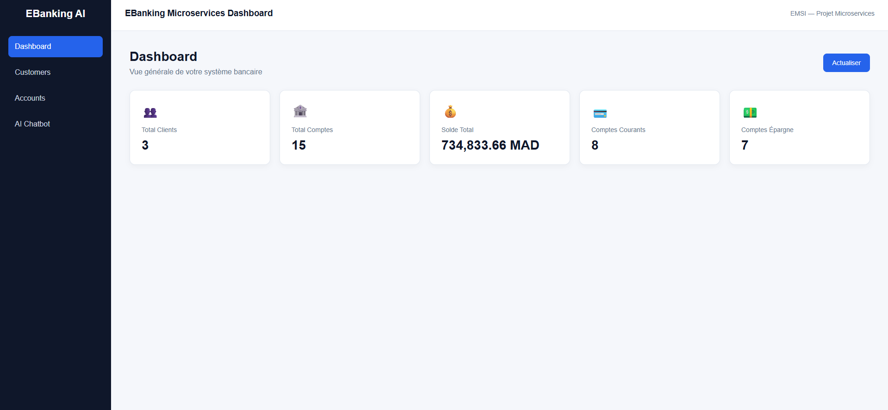
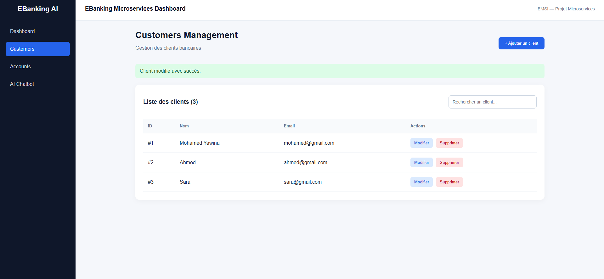
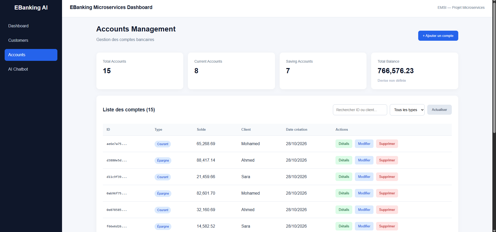
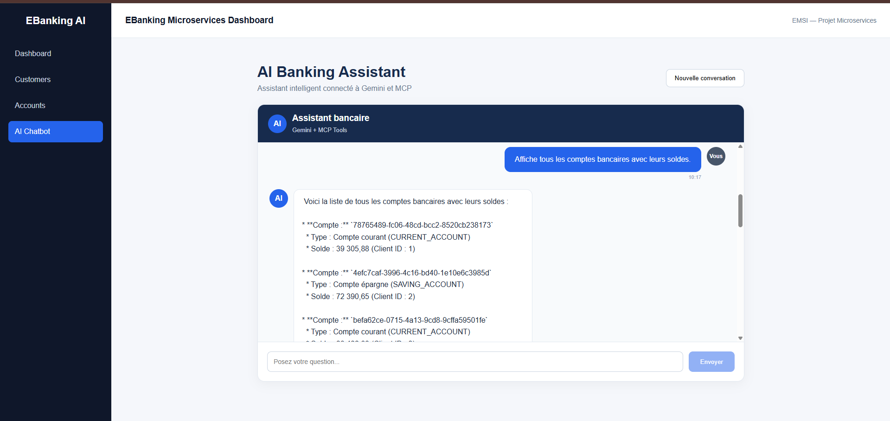
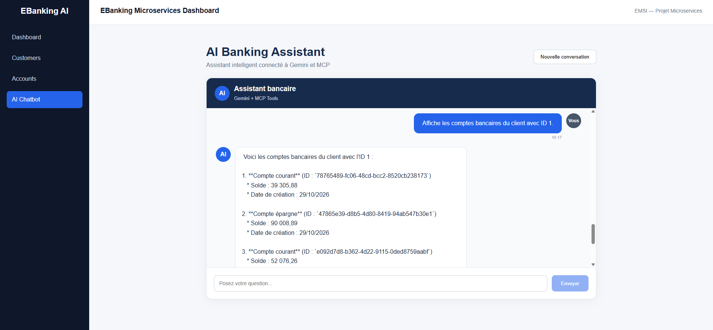
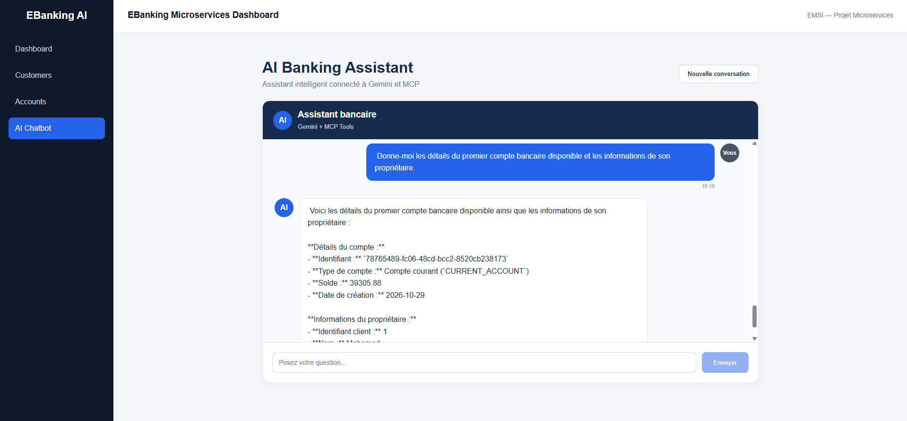
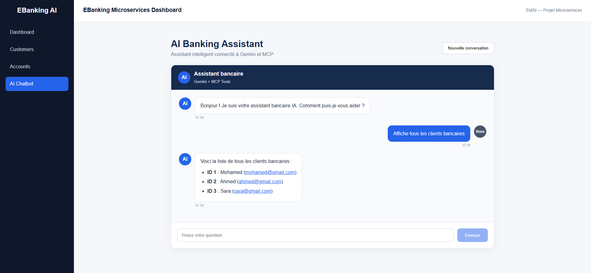
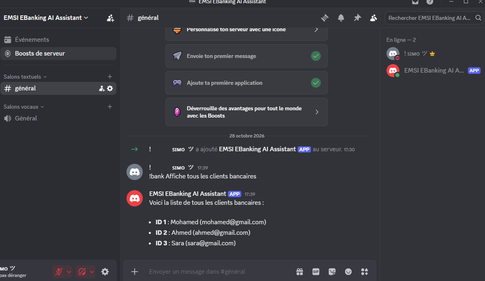
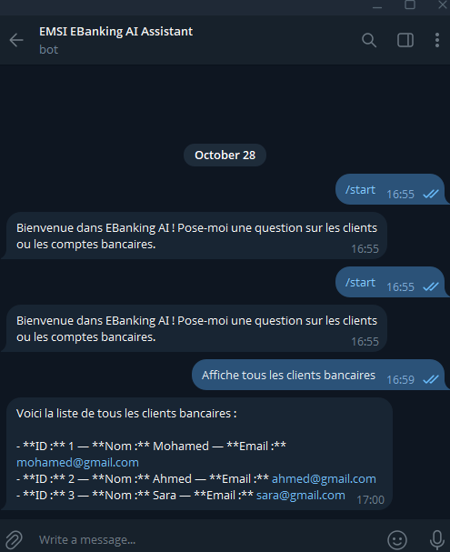

<div align="center">

# 🏦 E-Banking Microservices Platform

### Cloud-Native Banking Application with AI-Powered Assistance

**Spring Boot · Spring Cloud · Angular 22 · Docker · Google Gemini · MCP**

A full-stack banking management platform built with a distributed microservices architecture, combining modern backend technologies, a responsive web interface, and AI-powered integrations.

[](https://www.java.com/)
[](https://spring.io/projects/spring-boot)
[](https://angular.dev/)
[](https://www.docker.com/)
[](https://spring.io/projects/spring-cloud)


**[Overview](#-project-overview) · [Architecture](#-system-architecture) · [Features](#-key-features) · [Screenshots](#-application-screenshots) · [Installation](#-getting-started)**

</div>

---

## 📖 Project Overview

E-Banking Microservices Platform is an academic software engineering project designed to demonstrate the development of a distributed banking application using Spring Boot, Spring Cloud, and Angular.

The platform combines traditional banking operations with modern microservices concepts and AI-powered interactions.

### Project Objectives

- Design a modular and distributed banking application.
- Implement independent microservices using Spring Boot.
- Enable service discovery through Netflix Eureka.
- Centralize application configuration using Spring Cloud Config.
- Route API requests through Spring Cloud Gateway.
- Develop an interactive Angular frontend.
- Integrate an AI-powered banking assistant using Google Gemini.
- Explore Model Context Protocol (MCP) integration.
- Containerize the application using Docker Compose.

> **Note:** This is an educational demonstration project, not a production banking system.

---

## ✨ Key Features

### 👥 Customer Management

- Retrieve customer information through REST APIs.
- Display customer records in the Angular interface.
- Integrate the frontend with the Customer microservice.

### 💳 Bank Account Management

- Access banking account information.
- Display account records through the web application.
- Connect banking operations to the dedicated E-Bank microservice.

### 📊 Banking Dashboard

- Centralized interface for banking information.
- Navigation between customers, accounts, and other application features.
- Angular-based user experience.

### 🤖 AI-Powered Banking Assistant

- Conversational assistant based on Google Gemini.
- Dedicated AI Chatbot microservice.
- AI interactions accessible through the banking application.
- MCP integration for tool-based AI interactions.

### 💬 Messaging Integrations

The project also includes integrations involving:

- Telegram Bot API
- Discord through JDA

These integrations depend on valid external credentials and their corresponding service configurations.

### ☁️ Microservices Infrastructure

- Service registration and discovery with Eureka.
- API routing through Spring Cloud Gateway.
- Centralized configuration through Spring Cloud Config.
- OpenFeign and Spring Cloud LoadBalancer dependencies.
- Resilience4J integration dependencies.
- Docker Compose orchestration.

---

## 🏗️ System Architecture

The application follows a distributed microservices architecture.

```text
                         USER
                          |
                          v
                  Angular Frontend
                    (Port 4200)
                          |
                          v
                 Spring Cloud Gateway
                    (Port 8080)
                          |
          +---------------+----------------+
          |               |                |
          v               v                v
   Customer Service   E-Bank Service   AI Chatbot
      (8081)             (8082)          (8084)
          |               |                |
          v               v                +---- Google Gemini
      H2 Database     H2 Database          |
                                           +---- MCP Server (8085)
                                           |
                                           +---- Telegram / Discord


              INFRASTRUCTURE SERVICES
          +--------------------------------+
          | Eureka Discovery  : 8761       |
          | Spring Config     : 8888       |
          | Docker Compose                 |
          +--------------------------------+
```

### Architecture Components

**Frontend Layer**

Angular 22 provides the web interface for interacting with the banking platform.

**API Gateway Layer**

Spring Cloud Gateway acts as the main entry point and routes requests to the corresponding microservices.

**Business Services Layer**

Independent services handle customer management, banking operations, and AI interactions.

**Infrastructure Layer**

Eureka, Config Server, and Docker Compose support service discovery, centralized configuration, and container orchestration.

---

## 🧩 Microservices

| Microservice | Port | Responsibility |
|---|---:|---|
| Config Service | 8888 | Centralized configuration |
| Discovery Service | 8761 | Eureka service registry |
| Gateway Service | 8080 | API Gateway and routing |
| Customer Service | 8081 | Customer management |
| E-Bank Service | 8082 | Banking account operations |
| AI Chatbot Service | 8084 | Gemini-powered assistant |
| MCP Server Service | 8085 | MCP integration |
| Angular Frontend | 4200 | Web application |

### Gateway Routes

The following routes are defined in the configuration repository:

| Route | Destination |
|---|---|
| `/customers/**` | Customer Service |
| `/accounts/**` | E-Bank Service |
| `/chat/**` | AI Chatbot Service |

Route definitions can be found in:

`ebanking-config-repo/gateway-service.properties`

---

## 🛠️ Technology Stack

| Category | Technologies |
|---|---|
| Programming Languages | Java 17, TypeScript |
| Backend | Spring Boot 4.1.2, Spring Web MVC |
| Microservices | Spring Cloud, Eureka, OpenFeign |
| API Gateway | Spring Cloud Gateway |
| Configuration | Spring Cloud Config |
| Resilience | Resilience4J, Spring Cloud LoadBalancer |
| Persistence | Spring Data JPA, H2 Database |
| Frontend | Angular 22, HTML, CSS |
| Artificial Intelligence | Spring AI, Google Gemini |
| AI Tool Integration | Model Context Protocol (MCP) |
| Messaging | Telegram, Discord (JDA) |
| DevOps | Docker, Docker Compose, Nginx |
| Build & Version Control | Maven, npm, Git, GitHub |

---

## 📸 Application Screenshots

The following screenshots illustrate the banking interface and AI integration features.

### 1. Banking Dashboard

Main dashboard of the E-Banking application.



### 2. Customer Management

Interface for viewing customer information.



### 3. Bank Account Management

Interface displaying banking account information.



### 4. AI Banking Assistant

The application includes an AI-powered conversational interface.



#### Additional AI Interactions







### 5. Discord Integration

Screenshot illustrating the Discord integration.



### 6. Telegram Integration

Screenshot illustrating the Telegram integration.



---

## 📂 Project Structure

```text
ebanking-microservices-spring-cloud/
|
|-- ai-chatbot-service/
|-- config-service/
|-- customer-service/
|-- discovery-service/
|-- ebank-service/
|-- gateway-service/
|-- mcp-server-service/
|
|-- ebanking-angular/
|   `-- Angular frontend
|
|-- ebanking-config-repo/
|   `-- Centralized configuration
|
|-- ebanking-docker/
|   |-- compose.yaml
|   `-- .env.example
|
|-- docs/
|   `-- screenshots/
|       |-- Dashboard.png
|       |-- Customers.png
|       |-- Accounts.png
|       |-- ChatAI.png
|       |-- ChatAI2.png
|       |-- ChatAI3.png
|       |-- ChatAI4.png
|       |-- Discord.png
|       `-- Telegram.png
|
|-- .gitignore
`-- README.md
```

---

## 🚀 Getting Started

### Prerequisites

Install the following tools:

- Git
- Docker Desktop
- Docker Compose
- Java 17 and Maven for local backend development
- Node.js and npm for frontend development

External API credentials are required for optional AI and messaging integrations.

### Step 1 — Clone the Repository

```bash
git clone https://github.com/mohamed-yawina/ebanking-microservices-spring-cloud.git

cd ebanking-microservices-spring-cloud
```

### Step 2 — Configure Environment Variables

On Windows PowerShell:

```powershell
Copy-Item .\ebanking-docker\.env.example .\ebanking-docker\.env
```

On Linux/macOS:

```bash
cp ebanking-docker/.env.example ebanking-docker/.env
```

Edit the `.env` file and configure the required environment variables.

Depending on the integrations enabled, these may include:

- Google Gemini API credentials
- Telegram Bot credentials
- Discord Bot credentials

**Never commit API keys or sensitive credentials to GitHub.**

### Step 3 — Validate Docker Compose

```bash
docker compose --env-file ebanking-docker/.env -f ebanking-docker/compose.yaml config
```

### Step 4 — Build and Start the Application

```bash
docker compose -f ebanking-docker/compose.yaml up --build -d
```

### Step 5 — Verify Running Containers

```bash
docker compose -f ebanking-docker/compose.yaml ps
```

### Step 6 — Access the Application

| Application | URL |
|---|---|
| Angular Frontend | http://localhost:4200 |
| API Gateway | http://localhost:8080 |
| Eureka Dashboard | http://localhost:8761 |
| Config Server | http://localhost:8888 |

These URLs assume the documented Docker port mappings and a successful startup.

### Step 7 — View Logs

```bash
docker compose -f ebanking-docker/compose.yaml logs --tail=100 gateway-service
```

### Step 8 — Stop the Application

```bash
docker compose -f ebanking-docker/compose.yaml down
```

---

## 🧪 Testing and Verification

### Backend Tests

From an individual microservice directory:

```bash
./mvnw test
```

On Windows:

```powershell
.\mvnw.cmd test
```

### Angular Build

```bash
cd ebanking-angular
npm ci
npm run build
```

### Angular Tests

```bash
npm test
```

### Docker Verification

```bash
docker compose -f ebanking-docker/compose.yaml ps
```

These commands are provided for reproducibility. Passing results have not been independently verified as part of this documentation.

---

## 🔐 Configuration and Security

- Centralized configuration is maintained in `ebanking-config-repo/`.
- Environment variables are used for optional external integrations.
- Sensitive credentials must not be committed to Git.
- Development databases use H2 in-memory storage.
- Banking data should be considered temporary in the current demonstration setup.

### Production Considerations

Before any production deployment, the platform would require:

- Authentication and role-based authorization.
- HTTPS and secure communication.
- Persistent database infrastructure.
- Centralized secrets management.
- Security testing and dependency auditing.
- Monitoring, logging, and observability.
- Backup and recovery mechanisms.

---

## ⚠️ Project Status and Limitations

This repository is intended for academic learning and experimentation.

Important considerations:

1. **Persistence:** H2 in-memory databases do not provide durable banking data storage.
2. **External integrations:** Gemini, Telegram, and Discord depend on valid credentials and service availability.
3. **Docker networking:** Eureka URLs and other service addresses must resolve correctly inside Docker containers.
4. **Dependency compatibility:** Spring Boot and Spring Cloud dependency versions should be checked across modules.
5. **Runtime validation:** A complete end-to-end build and automated test report has not been established in this documentation.
6. **Security:** The project is not suitable for real financial transactions without substantial security hardening.

---

## 🎓 Learning Outcomes

This project provides practical experience with:

- Microservices architecture and distributed systems.
- REST API design and integration.
- Service discovery and centralized configuration.
- API Gateway routing.
- Inter-service communication.
- Frontend/backend integration.
- AI-assisted applications and MCP concepts.
- Docker-based application orchestration.
- Software engineering and Git version control.

---

## 👨‍💻 Author

**Mohamed Yawina**

Software Engineering Student — EMSI, Morocco

Interested in backend development, microservices, cloud technologies, and artificial intelligence.

[GitHub](https://github.com/mohamed-yawina) · [LinkedIn](https://www.linkedin.com/in/mohamed-yawina/)

---

<div align="center">

**Built with Spring Boot, Spring Cloud, Angular and AI technologies.**

*Academic Project — E-Banking Microservices Platform*

</div>
